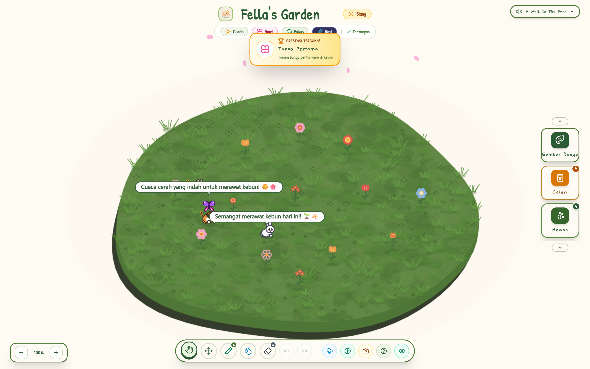
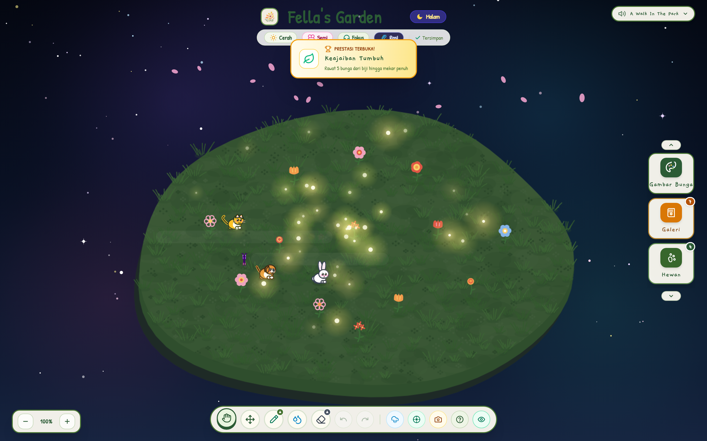
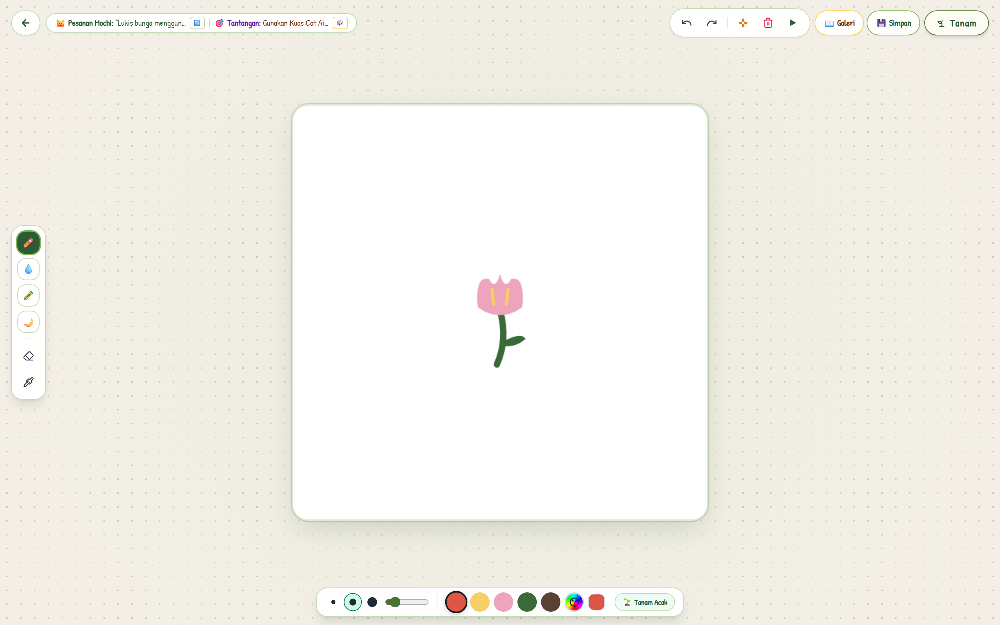
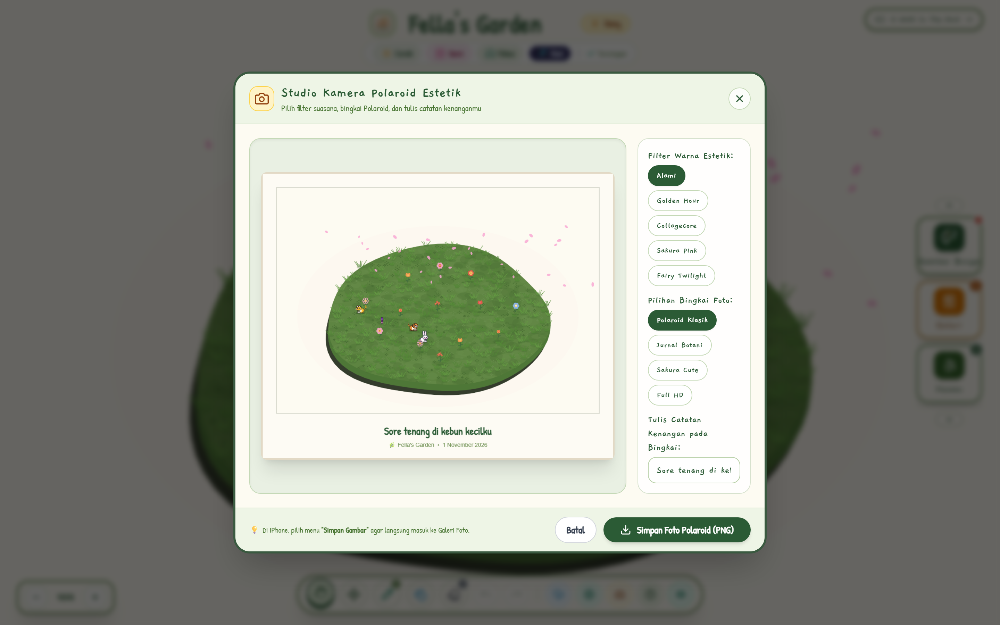
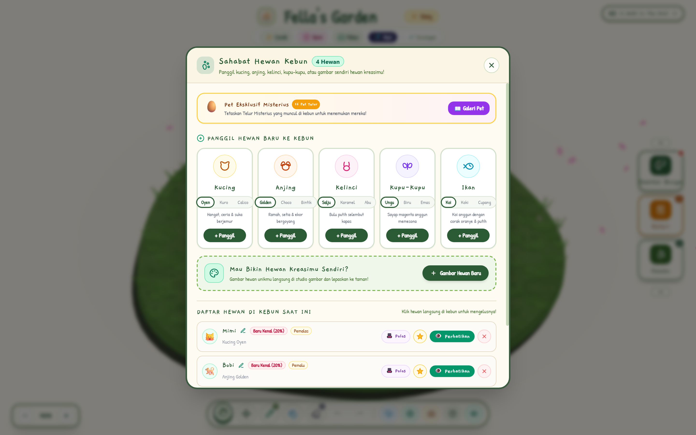
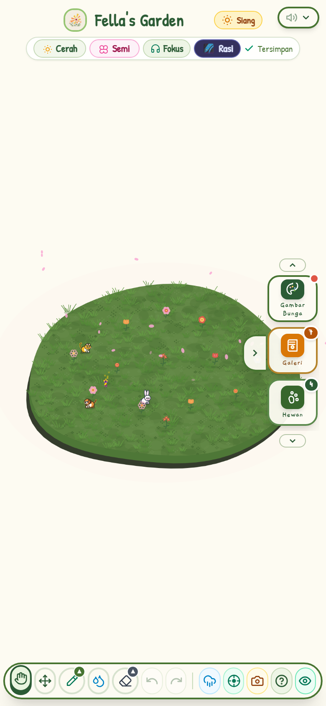

<div align="center">

  

  # 🌸 Fella's Garden

  **A cozy, relaxing virtual garden simulation & creative sanctuary in your browser.**  
  *Lukis pulau kebunmu, rawat hewan-hewan lucu, ciptakan bunga kreasi sendiri, dan nikmati alunan musik yang menenangkan.*

  [](https://fellas-garden.vercel.app)
  [](LICENSE)
  [](#)
  [](#)
  [](#)

</div>

---

## 📖 Tentang Fella's Garden

**Fella's Garden** adalah game simulasi kebun virtual santai (*cozy garden sandbox*) berbasis web yang dirancang untuk memberikan ruang relaksasi, kreativitas menggambar, dan ketenangan pikiran. Tanpa beban kompetisi, pemain diajak untuk membentuk pulau terapung hijau, menggambar tanaman serta hewan sahabat sesuai imajinasi, menyusun rasi bintang di langit malam, dan menikmati melodi akustik yang menenangkan.

Game ini sepenuhnya dibangun menggunakan **Vanilla JavaScript** dan **HTML5 Canvas** murni dengan performa rendering 60 FPS yang ringan, tanpa ketergantungan framework berat.

---

## ✨ Fitur Unggulan

### 🌿 1. Membentuk Medan & Ekosistem Kebun
* **Kuas Medan Hijau (Terrain Sculpting)**: Perluas dan bentuk tanah kebun terapung sesuka hati dengan simulasi kedalaman tebing 3D prosedural.
* **Kuas Kolam & Sungai**: Buat kolam air jernih atau parit alami tempat berenang ikan hias.
* **Rerumputan Dinamis**: Setiap jengkal pulau ditumbuhi helai rumput hijau lembut yang bergoyang saat tertiup angin sepoi-sepoi.
* **Musim & Cuaca**: Alami pergantian musim (Semi, Panas, Gugur, Dingin) dan ragam cuaca (Cerah, Hujan rintik sejuk, Salju lembut).

### 🎨 2. Studio Menggambar Bebas (Bunga & Hewan)
* **Kuas Artistik**: Tersedia pilihan kuas Pensil, Cat Air (*Watercolor*), Krayon, dan Kuas Cahaya Neon.
* **Fitur Menggambar Lengkap**: Palet warna lengkap, pipet (*eyedropper*), undo/redo berulang, dan tombol tanam langsung ke kebun.
* **Touch Pinch-to-Zoom & Pan Gesture**: Menggambar di smartphone sangat nyaman dengan gestur 2 jari untuk zoom & geser kertas secara alami layaknya aplikasi Procreate / ibis Paint tanpa meninggalkan noda kuas liar.

### 🐾 3. Hewan Peliharaan Interaktif & AI Tidur
* **Ragam Sahabat Lucu**: Mulai dari Kucing (*Oyen, Kuro, Calico*), Anjing (*Golden, Choco, Bintik*), Kelinci, Kupu-kupu, Ikan, hingga pet langka seperti **Orang Utan**, **Axolotl**, dan **Landak Imut**.
* **Bantal Tidur & Logika Mengantuk**: Hewan memiliki tingkat kantuk alami. Ketika lelah, mereka akan mencari bantal tidur empuk di kebun untuk terlelap pulas. Jika bantal dipindahkan, pet akan terbangun ceria!
* **Interaksi Ramah**: Elus, beri makan camilan favorit, dan perhatikan balon percakapan ceria dari setiap sahabat hewanmu.

### 🌌 4. Siklus Malam & Lukisan Rasi Bintang
* **Suasana Malam Syahdu**: Transisi malam hari yang tenang ditemani ribuan kunang-kunang bercahaya kuning hangat.
* **Rasi Bintang Interaktif**: Buat dan hubungkan bintang-bintang di angkasa malam. Rasi bintang dapat bergeser otomatis secara lembut (*cosmic drift*) atau disentuh dan dipindahkan posisinya di luar angkasa.

### 📸 5. Kamera Polaroid Estetik & Simpan Foto
* **Filter Estetik Vintage**: Pilihan filter suasana *Alami, Golden Hour, Cottagecore, Sakura Pink,* dan *Fairy Twilight*.
* **Bingkai Kenangan**: Pilih bingkai *Polaroid Klasik, Jurnal Botani,* atau *Sakura Cute*, lalu bubuhkan tulisan catatan manis.
* **Simpan Langsung ke Galeri (iOS & Android)**: Didukung integrasi *Web Share API* sehingga pengguna iPhone dapat langsung menyimpannya ke **Galeri Foto (Camera Roll)** dalam sekali sentuh.

### 🎵 6. Pemutar Musik Cozy & Mode Fokus (ASMR)
* **Daftar Putar Akustik & Lo-Fi**: Diiringi alunan instrumen piano, harpa, dan gitar yang damai (*A Walk In The Park, Moonlight Hush, Beat Homework, Cukies Zelda*).
* **Hemat Baterai & Latar Belakang**: Musik otomatis terjeda saat tab diminimalkan atau browser ditutup.
* **Screen Wake Lock**: Layar smartphone tetap menyala saat membuka game untuk menemani waktu belajar, kerja, atau tidur (*pomodoro focus companion*).

---

## 📸 Cuplikan Layar (Screenshots)

<div align="center">
  <table style="width: 100%; border: none;">
    <tr>
      <td width="50%" align="center">
        <b>🌸 Suasana Siang Kebun Fella</b><br/>
        
      </td>
      <td width="50%" align="center">
        <b>🌌 Angkasa Malam & Kunang-Kunang</b><br/>
        
      </td>
    </tr>
    <tr>
      <td width="50%" align="center">
        <b>🎨 Studio Menggambar Bunga</b><br/>
        
      </td>
      <td width="50%" align="center">
        <b>📸 Studio Kamera Polaroid</b><br/>
        
      </td>
    </tr>
    <tr>
      <td width="50%" align="center">
        <b>🐾 Manajemen & Pemanggilan Hewan</b><br/>
        
      </td>
      <td width="50%" align="center">
        <b>📱 Tampilan Responsif Mobile (Smartphone)</b><br/>
        
      </td>
    </tr>
  </table>
</div>

---

## 🛠️ Teknologi yang Digunakan

* **Core Engine**: HTML5 Canvas 2D API (Rendering ganda, isolasi layer offscreen, mask extrusion prosedural)
* **Language**: Vanilla JavaScript (ES6+ Native Modular Code, tanpa runtime framework)
* **Styling**: [Tailwind CSS](https://tailwindcss.com/) & Modern CSS Glassmorphism
* **Audio Engine**: [Tone.js](https://tonejs.github.io/) & Web Audio API untuk efek suara sintetis dan pemutar instrumen alam
* **Modern Web APIs**:
  - `Navigator.share` & `Web Share API` (Penyimpanan instan gambar ke galeri iOS / Android)
  - `Screen Wake Lock API` (Mencegah perangkat redup/tidur saat mendengarkan musik santai)
  - `Page Visibility API` (Manajemen cerdas jeda musik latar saat berganti tab)
  - `IndexedDB` & `LocalStorage` (Penyimpanan status kebun, jurnal, dan foto polaroid 100% lokal di browser)

---

## 🚀 Menjalankan Proyek Secara Lokal

Tidak memerlukan instalasi package `npm` yang rumit. Anda dapat langsung menjalankannya dalam hitungan detik:

1. **Clone repositori ini:**
   ```bash
   git clone https://github.com/SullKanaeru/fellas-garden.git
   cd fellas-garden
   ```

2. **Jalankan menggunakan web server lokal pilihan Anda:**

   *Menggunakan Node.js `npx serve`:*
   ```bash
   npx serve .
   ```

   *Menggunakan Python 3:*
   ```bash
   python -m http.server 8000
   ```

   *Atau gunakan ekstensi **Live Server** di Visual Studio Code.*

3. Buka browser dan arahkan ke alamat yang ditampilkan (misal: `http://localhost:3000` atau `http://localhost:8000`).

---

## 📁 Struktur Berkas

```
fella/
├── assets/
│   ├── images/         # Logo, ikon, dan aset grafis
│   └── sounds/         # Musik latar lo-fi dan efek suara (suara hewan, hujan, tanam)
├── css/
│   └── style.css       # Animasi kustom, tema font Patrick Hand, dan responsivitas
├── docs/
│   └── screenshots/    # Dokumentasi gambar tampilan game untuk GitHub
├── js/
│   ├── state.js        # Konfigurasi state global, kamera viewport, dan universal image saver
│   ├── garden.js       # Logika loop utama kebun, rendering rumput, bunga, dan rasi bintang
│   ├── animals.js      # AI perilaku hewan, jalur jalan, elusan, dan logika bantal tidur
│   ├── animal_studio.js# Studio gambar hewan kustom
│   ├── studio.js       # Studio gambar bunga dengan kuas pensil/cat air/cahaya
│   ├── features.js     # Kamera polaroid, cuaca, siklus musim, dan pencapaian (quests)
│   ├── audio.js        # Audio manager Tone.js & pemutar musik latar
│   └── world.js        # Sistem slot save dunia, ekspor/impor JSON
├── index.html          # File HTML utama dan struktur UI
└── vercel.json         # Konfigurasi deployment Vercel
```

---

## 📄 Lisensi

Proyek ini dirilis di bawah lisensi [MIT License](LICENSE). Anda bebas untuk mempelajari, memodifikasi, dan mengembangkan kode ini untuk keperluan edukasi maupun non-komersial.

---

<div align="center">
  Dibuat dengan penuh ❤️ dan kehangatan untuk menemani hari-harimu.<br/>
  <b><a href="https://fellas-garden.vercel.app">🌸 Mainkan Fella's Garden Sekarang 🌸</a></b>
</div>
